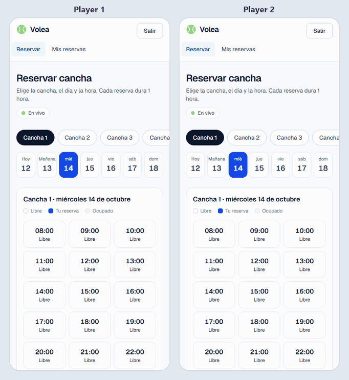
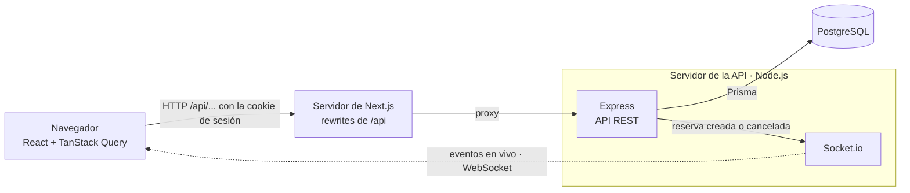

# Volea · Reserva de canchas en tiempo real

> **En construcción.**

Una app de reservas para un club de pádel ficticio. Los jugadores eligen una cancha y un día, ven los horarios libres y reservan uno. Cuando alguien reserva, el horario aparece ocupado al instante en la pantalla de todos los demás, sin recargar la página. Los administradores ven y manejan todas las reservas.



*Dos jugadores miran la misma cancha. El jugador 1 reserva las 17:00 y en la pantalla del jugador 2 aparece ocupada al instante. Después los dos eligen las 18:00, el jugador 1 la reserva primero y al jugador 2 se le avisa en el momento.*

## Tecnologías

- **API:** Node.js, Express 5 y TypeScript
- **Base de datos:** PostgreSQL con Prisma ORM (migraciones y datos de ejemplo)
- **Sesión:** JWT en una cookie httpOnly, contraseñas guardadas con bcrypt
- **Seguridad:** helmet, CORS y límite de intentos en el login
- **Validación:** Zod
- **Tiempo real:** Socket.io
- **Fechas y zonas horarias:** Luxon
- **Web:** Next.js 16 (App Router), React 19, Tailwind CSS 4 y TanStack Query
- **Tests:** Vitest, Supertest y Testing Library
- **Herramientas:** Docker Compose para la base de datos local y GitHub Actions para el CI

## Arquitectura



1. La página llama a `/api/...` en su mismo sitio, y el servidor de Next.js le pasa la petición a Express.
2. Express revisa la sesión y valida los datos con Zod. Después aplica las reglas de las reservas y guarda en PostgreSQL con Prisma.
3. Cuando se crea o se cancela una reserva, Express le avisa a Socket.io, que avisa a los navegadores que están mirando esa cancha.
4. Esos navegadores vuelven a pedir los horarios a la API REST.

## Estructura del proyecto

```
agenda-reservas/
├── api/                  ← API REST (Express + Prisma)
│   ├── prisma/           ← esquema de la base de datos, migraciones y datos de ejemplo
│   ├── src/
│   └── tests/
├── web/                  ← frontend (Next.js)
│   ├── app/              ← páginas: login, registro, reservar, mis-reservas, admin
│   ├── components/
│   ├── lib/              ← cliente de la API, hooks de datos, hook de tiempo real y funciones de fechas
│   └── tests/
├── docs/                 ← el GIF del demo
└── docker-compose.yml    ← PostgreSQL local
```

## Cómo correrlo en local

Necesitas Node.js 24 (ver `.nvmrc`) y Docker.

```bash
# 1. Levanta PostgreSQL
docker compose up -d

# 2. Prepara la API
cd api
cp .env.example .env   # después pon en JWT_SECRET un valor largo y al azar
npm install
npm run db:migrar    # crea las tablas
npm run db:seed      # agrega usuarios y canchas de ejemplo

# 3. Levanta la API
npm run dev

# 4. En otra terminal, levanta la web
cd web
npm install
npm run dev
```

Abre [http://localhost:3000](http://localhost:3000) y usa los botones **Jugador demo** o **Admin demo**. La API corre en [http://localhost:4000](http://localhost:4000).

La web le pasa a la API cada petición a `/api/...` (rewrites de Next.js). Para el navegador, la API está en el mismo sitio que la página, así que la cookie de sesión es propia (first-party) y no hay que lidiar con CORS. La conexión en tiempo real es la excepción: los rewrites no pueden mantener una conexión abierta, así que Socket.io se conecta directo a la API. Si la API corre en otro lugar, pon `NEXT_PUBLIC_API_URL` en `web/.env.local`.

### Usuarios de prueba

| Rol | Email | Contraseña |
|---|---|---|
| Admin | `admin@example.com` | `demo1234` |
| Jugador | `cliente@example.com` | `demo1234` |

## Rutas de la API

| Método | Ruta | Acceso | Qué hace |
|---|---|---|---|
| GET | `/api/salud` | público | Revisa que la API esté funcionando |
| POST | `/api/auth/registro` | público | Crea una cuenta de jugador e inicia sesión |
| POST | `/api/auth/login` | público | Inicia sesión (deja la cookie de sesión) |
| POST | `/api/auth/logout` | público | Cierra la sesión (borra la cookie de sesión) |
| GET | `/api/auth/yo` | con sesión | Devuelve el usuario actual |
| GET | `/api/recursos` | con sesión | Lista las canchas |
| GET | `/api/recursos/:id/disponibilidad?fecha=YYYY-MM-DD` | con sesión | Los horarios de un día: libre, ocupado, mío o pasado |
| POST | `/api/reservas` | jugador | Reserva un horario (`201`, o `409` si ya está ocupado) |
| GET | `/api/reservas/mias` | jugador | Mis próximas reservas |
| DELETE | `/api/reservas/:id` | dueño o admin | Cancela una reserva |
| GET | `/api/admin/reservas?fecha=YYYY-MM-DD` | admin | Todas las reservas de un día, de cualquier fecha |
| GET | `/api/admin/recursos` | admin | Todas las canchas, también las desactivadas |
| POST | `/api/admin/recursos` | admin | Crea una cancha |
| PATCH | `/api/admin/recursos/:id` | admin | Cambia el nombre de una cancha o la activa y desactiva |

Sin sesión, la API responde `401`; con sesión pero sin el rol correcto, `403`. Las canchas nunca se borran, solo se desactivan, así el historial de reservas queda completo.

Los errores siempre vuelven en JSON, por ejemplo `{ "error": "Email o contraseña incorrectos" }`. Los errores de validación (400) además traen `detalles`, con los problemas de cada campo.

## Reglas de las reservas

- Los horarios duran 1 hora y empiezan en punto, de 08:00 a 22:00 (hora del club, `America/Santiago`).
- Se puede reservar desde hoy hasta 6 días más adelante, pero nunca en el pasado.
- Una cancha no se puede reservar dos veces en el mismo horario. Si dos personas lo intentan al mismo tiempo, solo una lo consigue y la otra recibe un `409`.
- Cada jugador puede tener como máximo 2 reservas activas.
- Solo el dueño o un admin pueden cancelar una reserva, y solo antes de que empiece. Al cancelar, el registro se mantiene y el horario queda libre.

## Tiempo real

La API y Socket.io comparten un mismo servidor HTTP. Cuando se crea o se cancela una reserva, la API avisa a todos los navegadores que están mirando esa cancha, y cada uno vuelve a pedir sus horarios. Nadie tiene que recargar la página.

- Cada cancha tiene su propia **sala** de Socket.io (`recurso:<id>`). La página avisa qué canchas está mirando con `canchas:seguir`: un jugador sigue la cancha que tiene en pantalla, y el panel de admin las sigue todas.
- El servidor envía `reserva:creada` y `reserva:cancelada` con `{ recursoId, inicio }`. Nada más: en tiempo real no viajan nombres ni emails, así que el socket no necesita la cookie de sesión.
- En la página, un evento solo marca como desactualizados los datos de esa cancha, y TanStack Query los vuelve a pedir por la API normal. La API REST sigue siendo la única fuente de verdad.
- Si se corta la conexión, Socket.io se reconecta solo. Después la página vuelve a entrar a sus salas y actualiza todo, por si se perdió algún evento. Un pequeño indicador "En vivo" muestra si la conexión está activa.

## Decisiones técnicas

**La base de datos bloquea las reservas dobles.** Un índice único parcial sobre `(recursoId, inicio)` (la cancha y la hora de inicio) solo cuenta las reservas confirmadas. La API no pregunta "¿está libre este horario?" antes de guardar: dos peticiones podrían recibir un "sí" al mismo tiempo. Simplemente intenta guardar, y la base de datos deja pasar solo una. La otra recibe un `409`. Las reservas canceladas no cuentan, así que cancelar libera el horario.

**El límite de 2 reservas se cumple aunque lleguen peticiones al mismo tiempo.** Contar las reservas activas del jugador y crear la nueva pasan en una sola transacción que bloquea la fila del jugador (`SELECT ... FOR UPDATE`). Si el mismo jugador envía varias peticiones a la vez, esperan en fila en vez de pasar todas la revisión. Un test envía peticiones en paralelo, y falla si se quita el bloqueo.

**La sesión va en una cookie httpOnly, en el mismo sitio que la página.** El JWT (HS256, válido por 1 día) va en una cookie `httpOnly` y `SameSite=Lax`, así los scripts de la página no lo pueden leer. La web llega a la API por los rewrites de Next.js, así que la cookie es propia del sitio aunque la API esté en otro dominio. Eso importa porque Safari bloquea las cookies de terceros. También significa que la API REST no necesita CORS.

**401 y 403 significan cosas distintas.** `requiereSesion` responde "¿quién eres?" (`401`), y `soloRoles` responde "¿tienes permiso?" (`403`). El rol se lee del token, sin consultar la base de datos. La contra: si un admin cambia el rol de alguien, el cambio se aplica cuando vence su token.

**Las horas se guardan en UTC y se muestran en la hora del club.** Los días y los horarios se calculan en `America/Santiago` con Luxon. El servidor también decide qué día es "hoy" (`GET /api/horario`), así un reloj o una zona horaria mal configurados en el dispositivo del visitante no pueden cambiar las reglas de las reservas.

**Los eventos en tiempo real son solo una señal.** Un evento dice qué cancha y qué horario cambiaron, y nada más: ni nombres ni emails, así que el socket no necesita sesión. La página marca esos datos como desactualizados y TanStack Query los vuelve a pedir a la API REST, que sigue siendo la única fuente de verdad. No hay una segunda copia del estado que mantener sincronizada, y si se pierde un evento, se arregla volviendo a pedir todo al reconectarse.

**No se borra nada.** Cancelar una reserva cambia su estado, y las canchas se desactivan en vez de borrarse. El historial de reservas queda completo.

**Los tests usan un PostgreSQL de verdad.** Las reglas más importantes viven en la base de datos (el índice único y el bloqueo de fila), y una base de datos simulada las escondería. Los tests corren contra Docker en local y contra un servicio de PostgreSQL en el CI. Cada test crea su propia cancha y sus jugadores y los borra al final. `crearApp()` arma la app de Express sin abrir un puerto, así Supertest la puede usar directo. El "notificador" de tiempo real se le pasa a la app, así un test lo puede cambiar por uno falso.

**Los datos se revisan en la entrada.** Zod valida el cuerpo y los parámetros de cada petición, y también las variables de entorno al partir: si falta una, la API no parte y dice cuál falta.

## Tests y CI

- **API:** 50 tests con Vitest y Supertest: sesión, reglas de las reservas (incluido dos personas reservando el mismo horario), roles y permisos, y eventos en tiempo real con clientes de Socket.io de verdad.
- **Web:** 21 tests con Vitest y Testing Library: el cliente de la API, las funciones de fechas, la grilla de horarios y el hook de tiempo real.
- **CI:** GitHub Actions corre lint, tipos, tests y build de los dos proyectos en cada push. El trabajo de la API levanta su propio PostgreSQL.

## Limitaciones conocidas

- Todos comparten la cuenta "Jugador demo", y un jugador puede tener solo 2 reservas activas, así que la cuenta demo se puede llenar. Se arreglaría reiniciando los datos de prueba cada noche.
- No hay refresh tokens: la sesión dura 1 día y después hay que volver a iniciar sesión.
- "Mis reservas" no se actualiza en vivo. Se actualiza al volver a la pestaña. Para enviarle cambios haría falta una sala privada por usuario, revisando la sesión en el socket.
- El límite de intentos del login y las salas de Socket.io viven en la memoria de un solo proceso de la API. Para correr varias copias de la API haría falta un almacenamiento compartido, como Redis, para las dos cosas.

## Comandos

Dentro de `api/`:

| Comando | Qué hace |
|---|---|
| `npm run dev` | Levanta la API y la reinicia con cada cambio |
| `npm run build` | Compila TypeScript a `dist/` |
| `npm start` | Corre la API compilada |
| `npm run lint` | Revisa el código con ESLint |
| `npm run typecheck` | Revisa los tipos de TypeScript |
| `npm test` | Corre los tests |
| `npm run db:migrar` | Aplica las migraciones (y crea nuevas después de cambiar el esquema) |
| `npm run db:seed` | Carga los datos de prueba |
| `npm run db:reiniciar` | Borra todo y vuelve a armar la base de datos desde cero |

Dentro de `web/`: `npm run dev`, `npm run build`, `npm start`, `npm run lint`, `npm run typecheck` y `npm test` hacen lo mismo para la web.

## Licencia

[MIT](LICENSE)
