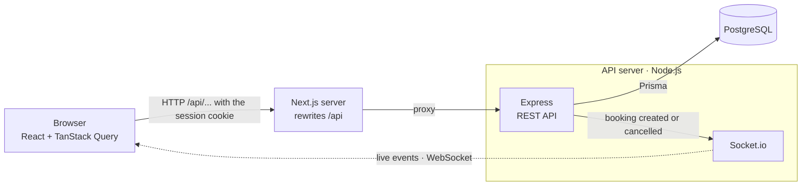

# Volea · Real-time Court Booking

> **Work in progress.**

A booking app for a fictional padel club. Players pick a court and a day, see the free time slots and book one. When someone books, the slot turns busy on everyone else's screen at once, without reloading the page. Admins see and manage all bookings.


*Two players look at the same court. Player 1 books 17:00 and it turns busy on Player 2's screen at once. Then both pick 18:00, Player 1 books it first, and Player 2 is told right away.*

## Tech stack

- **API:** Node.js, Express 5 and TypeScript
- **Database:** PostgreSQL with Prisma ORM (migrations and seed data)
- **Auth:** JWT in an httpOnly cookie, passwords hashed with bcrypt
- **Security:** helmet, CORS and rate limiting on login
- **Validation:** Zod
- **Real time:** Socket.io
- **Dates and time zones:** Luxon
- **Web:** Next.js 16 (App Router), React 19, Tailwind CSS 4 and TanStack Query
- **Tests:** Vitest, Supertest and Testing Library
- **Tooling:** Docker Compose for the local database, GitHub Actions for CI

## Architecture



1. The page calls `/api/...` on its own site, and the Next.js server forwards the request to Express.
2. Express checks the session and validates the input with Zod. It then applies the booking rules and saves to PostgreSQL through Prisma.
3. When a booking is created or cancelled, Express tells Socket.io, which notifies the browsers watching that court.
4. Those browsers fetch the time slots again through the REST API.

## Project structure

```
agenda-reservas/
├── api/                  ← REST API (Express + Prisma)
│   ├── prisma/           ← database schema, migrations and seed data
│   ├── src/
│   └── tests/
├── web/                  ← frontend (Next.js)
│   ├── app/              ← pages: login, registro, reservar, mis-reservas, admin
│   ├── components/
│   ├── lib/              ← API client, data hooks, real-time hook and date helpers
│   └── tests/
├── docs/                 ← the demo GIF
└── docker-compose.yml    ← local PostgreSQL
```

## Run it locally

You need Node.js 24 (see `.nvmrc`) and Docker.

```bash
# 1. Start PostgreSQL
docker compose up -d

# 2. Set up the API
cd api
cp .env.example .env   # then set JWT_SECRET to a long random value
npm install
npm run db:migrar    # creates the tables
npm run db:seed      # adds demo users and courts

# 3. Start the API
npm run dev

# 4. In another terminal, start the web app
cd web
npm install
npm run dev
```

Open [http://localhost:3000](http://localhost:3000) and use the **Jugador demo** (player) or **Admin demo** buttons (the UI is in Spanish). The API runs on [http://localhost:4000](http://localhost:4000).

The web app forwards every `/api/...` request to the API (Next.js rewrites). To the browser, the API lives on the same site as the page, so the session cookie is first-party and there is no CORS to deal with. The real-time connection is the exception: rewrites can't carry a long-lived connection, so Socket.io connects straight to the API. Set `NEXT_PUBLIC_API_URL` in `web/.env.local` if the API runs somewhere else.

### Demo users

| Role | Email | Password |
|---|---|---|
| Admin | `admin@example.com` | `demo1234` |
| Player | `cliente@example.com` | `demo1234` |

## API endpoints

| Method | Route | Access | What it does |
|---|---|---|---|
| GET | `/api/salud` | public | Health check |
| POST | `/api/auth/registro` | public | Creates a player account and signs in |
| POST | `/api/auth/login` | public | Signs in (sets the session cookie) |
| POST | `/api/auth/logout` | public | Signs out (clears the session cookie) |
| GET | `/api/auth/yo` | signed in | Returns the current user |
| GET | `/api/recursos` | signed in | Lists the courts |
| GET | `/api/recursos/:id/disponibilidad?fecha=YYYY-MM-DD` | signed in | Time slots of a day: free, taken, mine or past |
| POST | `/api/reservas` | player | Books a slot (`201`, or `409` if it is already taken) |
| GET | `/api/reservas/mias` | player | My upcoming bookings |
| DELETE | `/api/reservas/:id` | owner or admin | Cancels a booking |
| GET | `/api/admin/reservas?fecha=YYYY-MM-DD` | admin | All bookings of a day, any date |
| GET | `/api/admin/recursos` | admin | All courts, including inactive ones |
| POST | `/api/admin/recursos` | admin | Creates a court |
| PATCH | `/api/admin/recursos/:id` | admin | Renames a court or turns it on/off |

Without a session the API answers `401`; with a session but the wrong role, `403`. Courts are never deleted, only turned off, so the booking history stays complete.

Errors always come back as JSON, for example `{ "error": "Email o contraseña incorrectos" }`. Validation errors (400) also include `detalles`, with the problems for each field.

## Booking rules

- Slots last 1 hour and start on the hour, from 08:00 to 22:00 (club time, `America/Santiago`).
- You can book from today up to 6 days ahead, but never in the past.
- A court can't be booked twice for the same slot. If two people try at the same moment, only one gets it and the other gets a `409`.
- Each player can have at most 2 active bookings.
- Only the owner or an admin can cancel a booking, and only before it starts. Cancelling keeps the record and frees the slot.

## Real-time updates

The API and Socket.io share one HTTP server. When a booking is created or cancelled, the API tells every browser that is looking at that court, and each one fetches its time slots again. Nobody has to reload the page.

- Each court has its own Socket.io **room** (`recurso:<id>`). The page says which courts it is watching with `canchas:seguir`: a player follows the court on screen, and the admin panel follows all of them.
- The server sends `reserva:creada` and `reserva:cancelada` with `{ recursoId, inicio }`. That is all: no names or emails travel in real time, so the socket doesn't need the session cookie.
- On the page, an event just marks that court's data as stale and TanStack Query fetches it again through the normal API. The REST API stays the only source of truth.
- If the connection drops, Socket.io reconnects on its own. The page then joins its rooms again and refreshes everything, in case it missed an event. A small "En vivo" badge shows whether the connection is up.

## Technical decisions

**The database blocks double bookings.** A partial unique index on `(court, start)` only counts confirmed bookings. The API doesn't ask "is this slot free?" before saving: two requests could both get a "yes" at the same moment. It just tries to insert, and the database lets only one through. The other one gets a `409`. Cancelled bookings don't count, so cancelling frees the slot.

**The 2-booking limit holds under concurrency.** Counting a player's active bookings and creating the new one happen in one transaction that locks the player's row (`SELECT ... FOR UPDATE`). If the same player sends several requests at once, they wait in line instead of all passing the check. A test sends parallel requests, and it fails if the lock is removed.

**The session lives in an httpOnly cookie, on the same site as the page.** The JWT (HS256, valid for 1 day) goes in an `httpOnly`, `SameSite=Lax` cookie, so page scripts can't read it. The web app reaches the API through Next.js rewrites, so the cookie is first-party even if the API is hosted on another domain. That matters because Safari blocks third-party cookies. It also means the REST API needs no CORS.

**401 and 403 mean different things.** `requiereSesion` answers "who are you?" (`401`), and `soloRoles` answers "are you allowed?" (`403`). The role is read from the token, without a database query. The trade-off: if an admin changes someone's role, it takes effect when their token expires.

**Times are stored in UTC and shown in club time.** Days and slots are calculated in `America/Santiago` with Luxon. The server also decides what "today" is (`GET /api/horario`), so a wrong clock or time zone on the visitor's device can't change the booking rules.

**Real-time events are only a signal.** An event says which court and slot changed, and nothing else: no names, no emails, so the socket needs no session. The page marks that data as stale and TanStack Query fetches it again from the REST API, which stays the single source of truth. There is no second copy of the state to keep in sync, and a missed event is fixed by refetching everything on reconnect.

**Nothing is deleted.** Cancelling a booking changes its status, and courts are turned off instead of deleted. The booking history stays complete.

**Tests use a real PostgreSQL.** The most important rules live in the database (the unique index and the row lock), and a mocked database would hide them. Tests run against Docker locally and a PostgreSQL service in CI. Each test creates its own court and players and deletes them at the end. `crearApp()` builds the Express app without opening a port, so Supertest can use it directly. The real-time "notifier" is passed into the app, so a test can swap in a fake one.

**Inputs are checked at the edges.** Zod validates every request body and query string, and also the environment variables at startup: if one is missing, the API refuses to start and says which one.

## Tests and CI

- **API:** 50 tests with Vitest and Supertest: auth, booking rules (including two people booking the same slot), roles and permissions, and real-time events with real Socket.io clients.
- **Web:** 21 tests with Vitest and Testing Library: the API client, date helpers, the time-slot grid and the real-time hook.
- **CI:** GitHub Actions runs lint, type check, tests and build for both projects on every push. The API job starts its own PostgreSQL.

## Known limitations

- Everyone shares the "Jugador demo" account, and a player can have only 2 active bookings, so the demo account can fill up. Resetting the demo data every night would fix it.
- There are no refresh tokens: the session lasts 1 day, and then you sign in again.
- "Mis reservas" is not live. It refreshes when you come back to the tab. Pushing changes to it would need a private room per user, with the session checked on the socket.
- The login rate limit and the Socket.io rooms live in the memory of one API process. Running several copies of the API would need a shared store, such as Redis, for both.

## Scripts

Inside `api/`:

| Command | What it does |
|---|---|
| `npm run dev` | Starts the API and restarts it on every change |
| `npm run build` | Compiles TypeScript to `dist/` |
| `npm start` | Runs the compiled API |
| `npm run lint` | Checks the code with ESLint |
| `npm run typecheck` | Checks the TypeScript types |
| `npm test` | Runs the tests |
| `npm run db:migrar` | Applies the migrations (and creates new ones after a schema change) |
| `npm run db:seed` | Loads the demo data |
| `npm run db:reiniciar` | Deletes everything and rebuilds the database from scratch |

Inside `web/`: `npm run dev`, `npm run build`, `npm start`, `npm run lint`, `npm run typecheck` and `npm test` do the same for the web app.

## License

[MIT](LICENSE)
